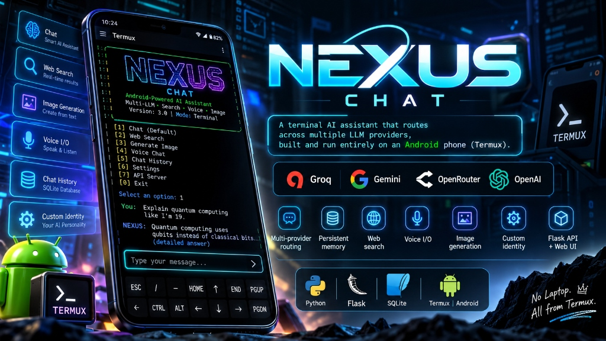
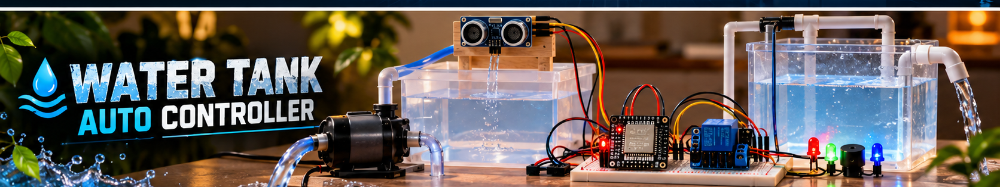
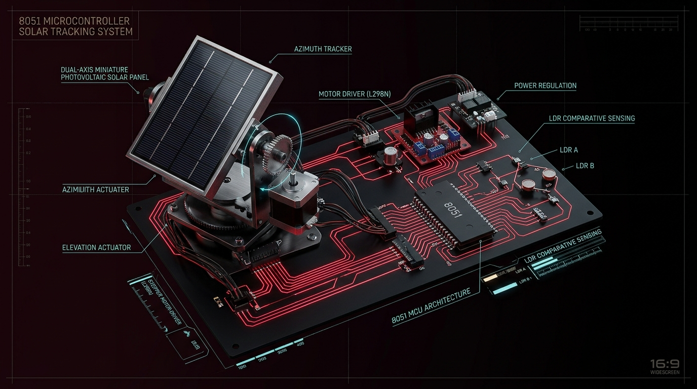
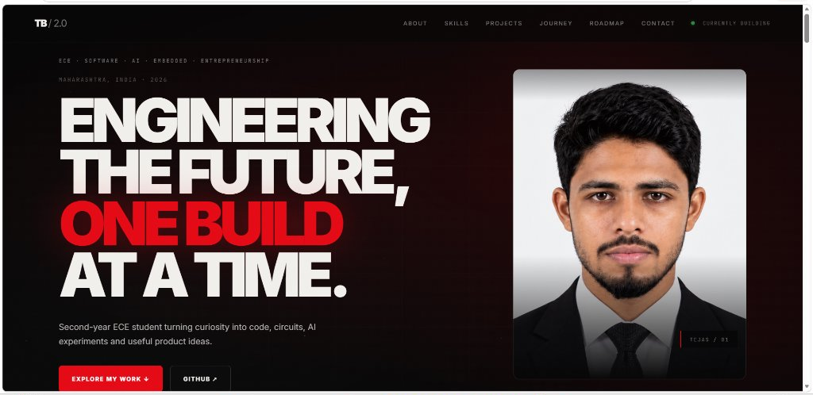
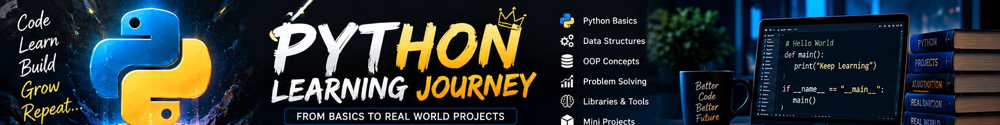
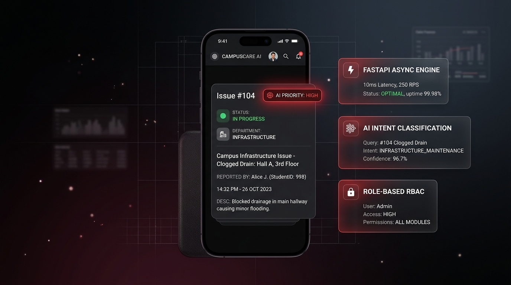

  <code>ECE · SOFTWARE · AI · EMBEDDED · ENTREPRENEURSHIP</code> &nbsp;•&nbsp; <code>MAHARASHTRA, INDIA · 2026</code>

 

<!-- HERO SECTION: 2-COLUMN EDITORIAL SHOWCASE (Matching Portfolio Design) -->
<table>
  <tr>
    <td width="60%" valign="top">
       
      <b>TB / 2.0</b> &nbsp; ● CURRENTLY BUILDING
        
      <h1>ENGINEERING THE FUTURE, ONE BUILD AT A TIME.</h1>
      
<strong>Second-year ECE student turning curiosity into code, circuits, AI experiments and useful product ideas.</strong>

       
      
      &nbsp;
      
      &nbsp;
      
      &nbsp;
      
        
      
    </td>
    <td width="40%" align="center" valign="middle">
      
       
      <small><code>TEJAS / 01 · 02 / ECE · TGPCET</code></small>
    </td>
  </tr>
</table>

 

### 👤 About

- **Study**: 2nd-year B.Tech in Electronics & Communication Engineering (ECE) with a Computer Science & Engineering (CSE) minor at TGPCET (RTMNU), Maharashtra.
- **Building**: Embedded IoT prototypes (dual water tank controller, 8051 solar tracker) and AI-driven software systems (Nexus AI, CampusCare AI) developed on Android via Termux.
- **Learning**: Digital circuit design, embedded C firmware, daily programming fundamentals across Python, Java, and C++, and structured preparation for GATE EC (2028).
- **Open to**: Engineering internships, technical collaboration, and open-source contributions in embedded systems, IoT, and software development.

 

### 🚀 Featured Projects

<!-- 2-COLUMN PROJECT CARDS (Matching Portfolio Showcase) -->
<table>
  <tr>
    <td width="50%" valign="top">
      
        
      <small><code>01 · AI ASSISTANT / SOFTWARE</code> &nbsp; <b style="color:#E50914;">BUILDING</b></small>
      <h3>Nexus AI</h3>
      
<em>Personal AI Assistant</em>

      
A mobile-first personal AI assistant concept inspired by intelligent assistant systems, exploring conversational interaction, memory architecture, web search integration, and modular plugins.

      <ul>
        <li>Conversational AI interface &amp; voice interaction</li>
        <li>Web search integration &amp; memory architecture</li>
        <li>Modular plugin architecture on Termux</li>
      </ul>
      

        <code>Python</code> <code>AI APIs</code> <code>Termux</code> <code>FastAPI</code> <code>SQLite</code>
      

      

        <a href="https://github.com/tejasbargat16-ux/Nexus-AIOS"><b>[ VIEW REPOSITORY ↗ ]</b></a>
      

    </td>
    <td width="50%" valign="top">
      
        
      <small><code>02 · ELECTRONICS / IOT</code> &nbsp; <b style="color:#E50914;">PROTOTYPED</b></small>
      <h3>Dual Water Tank Monitoring</h3>
      
<em>Automated Fluid Level &amp; Pump Control</em>

      
Two-tank water monitoring and automatic motor control system with sensor-based level detection, visual RGB status indicators, and audible buzzer alerts with overflow protection.

      <ul>
        <li>Two-tank real-time level sensing</li>
        <li>Visual RGB status indication &amp; audible buzzer alerts</li>
        <li>Automatic motor-cutoff relay logic</li>
      </ul>
      

        <code>Arduino UNO</code> <code>ESP32</code> <code>Sensors</code> <code>Embedded C</code> <code>Relay Control</code>
      

      

        <a href="https://github.com/tejasbargat16-ux/water-tank-auto-controller"><b>[ VIEW REPOSITORY ↗ ]</b></a>
      

    </td>
  </tr>
  <tr>
    <td width="50%" valign="top">
      
        
      <small><code>03 · EMBEDDED SYSTEMS</code> &nbsp; <b style="color:#E50914;">PROTOTYPE</b></small>
      <h3>Solar Tracking System</h3>
      
<em>Light-Seeking Energy Automation</em>

      
An 8051 microcontroller-based solar tracking concept utilizing light-dependent resistor (LDR) differential sensing and motor-driver control logic to follow peak sunlight.

      <ul>
        <li>Solar tracking concept &amp; differential LDR sensing</li>
        <li>Microcontroller-based motor control logic</li>
        <li>Energy harvesting optimization</li>
      </ul>
      

        <code>8051 MCU</code> <code>LDR Sensors</code> <code>Stepper Motor</code> <code>Embedded C</code> <code>Automation</code>
      

      

        <a href="https://github.com/tejasbargat16-ux"><b>[ VIEW REPOSITORY ↗ ]</b></a>
      

    </td>
    <td width="50%" valign="top">
      
        
      <small><code>04 · WEB DEVELOPMENT / BRANDING</code> &nbsp; <b style="color:#E50914;">DEPLOYED</b></small>
      <h3>Tejas 2.0 Portfolio</h3>
      
<em>Engineering Brand &amp; Technical Showcase</em>

      
A responsive personal engineering portfolio showcasing skills, hardware builds, AI experiments, public learning streaks, and architectural design language.

      <ul>
        <li>Editorial two-column hero architecture</li>
        <li>Dark cinematic engineering aesthetic</li>
        <li>Authentic project telemetry &amp; NEXUS AI chat</li>
        <li>Responsive cross-device layout</li>
      </ul>
      

        <code>React 19</code> <code>Vite</code> <code>JavaScript</code> <code>Modern CSS</code> <code>GitHub Pages</code>
      

      

        <a href="https://github.com/tejasbargat16-ux/Tejas-2.0-Portfolio"><b>[ VIEW REPOSITORY ↗ ]</b></a> &nbsp;
        <a href="https://tejasbargat16-ux.github.io/tejasbargat16-ux/portfolio/"><b>[ LIVE DEMO ↗ ]</b></a>
      

    </td>
  </tr>
  <tr>
    <td width="50%" valign="top">
      
        
      <small><code>05 · SOFTWARE DEVELOPMENT</code> &nbsp; <b style="color:#E50914;">ACTIVE LEARNING</b></small>
      <h3>Programming Learning Journey</h3>
      
<em>Daily Public Coding &amp; Fundamentals</em>

      
A disciplined day-by-day public learning journey covering Python, Java, JavaScript, and C fundamentals, LeetCode problem solving, and practical micro-builds committed to GitHub.

      <ul>
        <li>Python Learning Journey (Day 13+ Streak)</li>
        <li>Java Learning Journey on Android/Termux</li>
        <li>JavaScript DOM &amp; API practices</li>
        <li>LeetCode problem-solving practice</li>
      </ul>
      

        <code>Python</code> <code>Java</code> <code>JavaScript</code> <code>C</code> <code>Termux</code> <code>Git</code>
      

      

        <a href="https://github.com/tejasbargat16-ux/Python-Learning-Journey"><b>[ VIEW REPOSITORY ↗ ]</b></a>
      

    </td>
    <td width="50%" valign="top">
      
        
      <small><code>06 · AI / PRODUCT DEVELOPMENT</code> &nbsp; <b style="color:#E50914;">BUILDING</b></small>
      <h3>CampusCare AI</h3>
      
<em>AI-Powered Complaint Management</em>

      
An AI-powered campus complaint management platform combining Flutter mobile frontend with FastAPI backend, featuring role-based access, issue tracking, image uploads, priority analysis, and admin dashboards.

      <ul>
        <li>Flutter mobile UI &amp; FastAPI asynchronous backend</li>
        <li>AI-assisted priority classification</li>
        <li>Role-based administrative dashboards</li>
        <li>Photo attachment &amp; issue tracking</li>
      </ul>
      

        <code>Flutter</code> <code>FastAPI</code> <code>Python</code> <code>AI Priority Analysis</code> <code>REST APIs</code>
      

      

        <a href="https://github.com/tejasbargat16-ux/campuscareai_edition"><b>[ VIEW REPOSITORY ↗ ]</b></a>
      

    </td>
  </tr>
</table>

 

### 🛠️ Technical Skills

  

 

| Domain | Skills & Technologies |
| :--- | :--- |
| **Languages** | `C` · `C++` · `Python` (Day 13+ Streak) · `Java` · `JavaScript` · `Embedded C` |
| **Web Development** | `HTML5` · `CSS3` · `JavaScript (DOM)` · `Responsive Design` · `Frontend Development` |
| **Electronics & Embedded** | `8051 Microcontroller` · `Arduino UNO` · `ESP32` · `ESP8266` · `Digital Electronics` · `Digital Circuit Design` · `Microcontrollers` · `Sensors & Interfacing` · `Internet of Things (IoT)` · `Automation Systems` · `Basic Circuit Design` |
| **AI & Technology** | `AI Application Dev` · `AI-assisted development` · `Prompt Engineering` · `AI Automation` · `AI Product Prototyping` |
| **Dev Environment** | `VS Code` · `Git` · `GitHub` · `Termux` (Android) · `Pydroid` · `Android Dev Environment` |

 

### ⚡ Portfolio 2.0 & NEXUS AI Assistant

- **React 19 + Vite Architecture**: Cinematic, responsive personal portfolio built with React 19 and Vite 8, featuring dark theme styling, project showcases, and a 36-skill taxonomy.
- **Embedded NEXUS AI Dual-Engine**: Conversational representative integrated natively into the portfolio. Operates client-side with zero latency on GitHub Pages without API keys or server overhead, grounded strictly in verified background facts.
- **Optional Full-Stack LLM Backend**: Connects to Google Gemini, Groq, or OpenAI via Node/Express or serverless endpoints, with automated rate limiting and graceful failover to local mode.
- **Live Implementation**: Stream the interactive web experience directly at [tejasbargat16-ux.github.io/tejasbargat16-ux/portfolio/](https://tejasbargat16-ux.github.io/tejasbargat16-ux/portfolio/).

 

### 🗺️ Career Roadmap 2026 → 2028

- **2026 · Build the Base**: Strengthen programming fundamentals, second-year ECE courses, and consistent daily project building in public.
- **2027 · Connect the Disciplines**: Deepen embedded systems, AI integrations, and full-stack engineering through practical, working prototypes.
- **2028 · Test the Foundation**: Prepare rigorously for GATE 2028 across CSE/ECE interests and evaluate advanced technical horizons.
- **NEXT · Create What Matters**: Turn engineering range into useful products, startup experiments, and lasting technical depth.

 

### 📊 Viewing Stats

  
  
    
  
    
  

 

### 📬 Connect & Collaborate

Open to engineering internships, technical collaborations, and research discussions.

- **Email**: [tejasbargat16@gmail.com](mailto:tejasbargat16@gmail.com)
- **LinkedIn**: [linkedin.com/in/tejas-bargat-9ab8523b0](https://www.linkedin.com/in/tejas-bargat-9ab8523b0/)
- **GitHub**: [github.com/tejasbargat16-ux](https://github.com/tejasbargat16-ux)
- **Location**: Maharashtra, India

 

  

