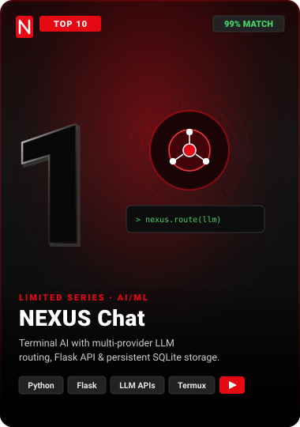
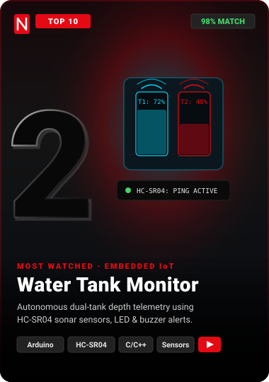
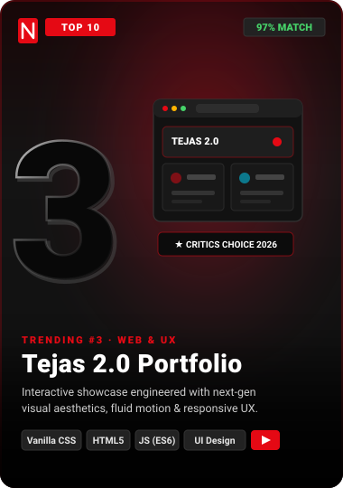
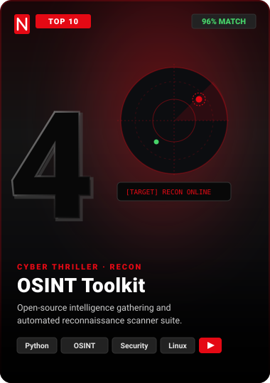

<div align="center">
  

  <a href="https://github.com/tejasbargat16-ux">
    
  </a>
  <br/><br/>

  <a href="https://github.com/tejasbargat16-ux/Tejas-2.0-Portfolio">
    
  </a>
  <a href="https://tejasbargat16-ux.github.io/tejasbargat16-ux/">
    
  </a>
  <a href="https://www.linkedin.com/in/tejas-bargat-9ab8523b0">
    
  </a>
  <a href="mailto:tejasbargat16@gmail.com">
    
  </a>
  <br/><br/>

  
</div>

<br/>

### 🎬 About This Series

> **TEJAS** · Drama · Tech · Coming-of-Age · TV-14 · 1 Season · Ongoing  
> A 2nd-year B.Tech ECE student with a CSE Minor at TGPCET (RTMNU), based in Wardha, Maharashtra. Preparing for GATE EC, chasing internships in Embedded, IoT, AI/ML, Software Dev & Cybersecurity, and shipping everything from an Android phone using Termux.

<br/>

### 🔥 Top 10 Projects in India Today

<div align="center">
  <a href="https://github.com/tejasbargat16-ux/nexuschat"></a>
  <a href="https://github.com/tejasbargat16-ux"></a>
  <a href="https://github.com/tejasbargat16-ux/Tejas-2.0-Portfolio"></a>
  <a href="https://github.com/tejasbargat16-ux"></a>
</div>

<br/>

### ⏯️ Continue Watching

| Title | Progress | Status |
| :--- | :---: | :---: |
| ☕ **Java** · [Learning Journey](https://github.com/tejasbargat16-ux/Java-Learning-Journey) |  | `40% Watched` |
| 🟨 **JavaScript** · [Learning Journey](https://github.com/tejasbargat16-ux/JavaScript-Learning-Journey) |  | `30% Watched` |
| 📡 **GATE EC** · Prep |  | `25% Streamed` |
| 🤖 **NEXUS Chat** · [Build](https://github.com/tejasbargat16-ux/nexuschat) |  | `Season 1 Active` |

<br/>

### 📈 Trending Now · Tech Stack

<div align="center">
  
</div>

<br/>

### 🏆 Coming Soon

- 🎯 **Internship Target**: TCS · Infosys · Wipro · LTTS · Qualcomm · Intel · NVIDIA
- 📡 **Exam Target**: Crack GATE EC
- 🚀 **Production Releases**: More embedded + AI projects, shipped publicly

<br/>

### 📊 Viewing Stats

<div align="center">
  
  
  <br/><br/>
  
  <br/><br/>
  
  <br/><br/>
  
</div>

---

<div align="center">

### 🍿 Experience the TEJASFLIX Interactive Web Experience
Launch the full responsive web app with interactive project simulators, live commit analytics, and synthesized Netflix audio:

```bash
# Clone the repository
git clone https://github.com/tejasbargat16-ux/tejasbargat16-ux.git

# Navigate to project directory
cd tejasbargat16-ux

# Start local streaming server (zero external npm dependencies required)
node scripts/serve.mjs
```

*Runs at `http://localhost:3000` with zero external dependencies.*

| Command | Action |
|:---|:---|
| `npm start` / `node scripts/serve.mjs` | Launch local streaming web app on port 3000 |
| `npm run generate` / `node generate.mjs` | Refresh SVG assets, rebuild heatmap & sync to `site/assets/` |
| `npm run contributions` | Fetch live contribution data from GitHub public profile |
| `npm run build:svg` | Re-render contribution snake SVG from data snapshot |

---

### 🏛️ Architecture & System Blueprint

TEJASFLIX is architected into two synchronized layers:

```
┌─────────────────────────────────────────────────────────────┐
│                    TEJASFLIX ECOSYSTEM                      │
├──────────────────────────────┬──────────────────────────────┤
│    GitHub Profile README     │   Interactive Web Stream     │
│   (Static SVG & Badges)      │   (Zero-Dep Vanilla App)     │
├──────────────────────────────┼──────────────────────────────┤
│ • assets/*.svg visual assets │ • site/index.html (HTML5)    │
│ • Real commit snake SVG      │ • site/style.css (Dark Mode) │
│ • Shields.io social badges   │ • site/app.js (Web Audio)    │
│ • Daily auto-refresh via CI  │ • Hardware & AI Simulators   │
└──────────────┬───────────────┴──────────────┬───────────────┘
               │                              │
               └──────────────┬───────────────┘
                              ▼
┌─────────────────────────────────────────────────────────────┐
│               AUTOMATION & PIPELINE (CI/CD)                 │
├─────────────────────────────────────────────────────────────┤
│ • .github/workflows/profile-heatmap.yml (Daily at 05:30 UTC)│
│ • .github/workflows/pages.yml (Continuous Deployment)       │
│ • generate.mjs (Automated build & asset synchronization)    │
└─────────────────────────────────────────────────────────────┘
```

#### 🛠️ Key Highlights:
1. **Audio Synthesis (Zero Audio Files)**: Custom Web Audio API synthesizer in `site/app.js` recreating the Netflix cinematic "Ta-Dum" intro chord using oscillators, low-pass filters, and harmonic sweeps.
2. **Interactive Hardware Simulators**: In-browser interactive models of the HC-SR04 Dual Water Tank, 8051 Dual-Axis Solar Tracker, Smart Irrigation controller, and NEXUS AI multi-provider terminal.
3. **Android-First Engineering**: Every line of code, circuit schematic, and commit was built and pushed from an Android smartphone via **Termux**.

---

### 📂 Directory Structure

```text
├── assets/                       # Profile SVGs and billboard graphics
│   ├── netflix-header.svg        # Cinematic Netflix billboard header
│   ├── card-*.svg                # Top 10 project poster cards
│   ├── contribution-snake.svg    # Animated slithering contribution heatmap
│   ├── poster-*.svg              # Project poster cards
│   └── row-*.svg                 # Netflix category divider SVGs
├── scripts/                      # Build, dev server and scraper scripts
│   ├── build-heatmap-svg.mjs     # Standalone heatmap SVG generator
│   ├── fetch-contributions.mjs   # Scrapes/fetches public GitHub contributions
│   └── serve.mjs                 # Zero-dependency local dev HTTP server
├── site/                         # Production web application (GitHub Pages)
│   ├── assets/                   # Synced SVGs and banner assets
│   ├── data/contributions.json   # Real contribution snapshot data
│   ├── index.html                # Semantic HTML5 interactive application
│   ├── style.css                 # Netflix design system stylesheet
│   └── app.js                    # Audio engine, simulators & event handlers
├── .github/workflows/            # GitHub Actions CI/CD automation
│   ├── pages.yml                 # Automated deployment to GitHub Pages
│   └── profile-heatmap.yml       # Daily automated contribution snake refresh
├── generate.mjs                  # Asset compilation & synchronization pipeline
├── package.json                  # Scripts and repository metadata
└── README.md                     # Profile presentation & documentation
```

<br/>

<div align="center">
  <p>Open to internships and collaborations. Hit ▶ PLAY on a repo and stay a while.</p>
  
</div>
