<a href="https://github.com/tejasbargat16-ux">
  
</a>

<p align="center">
  <a href="https://github.com/tejasbargat16-ux"></a>
  <a href="https://www.linkedin.com/in/tejas-bargat-9ab8523b0"></a>
  <a href="https://instagram.com/_tejas_bargat_01_"></a>
  <a href="mailto:tejasbargat16@gmail.com"></a>
</p>

<p align="center">
  <a href="https://tejasbargat16-ux.github.io/tejasbargat16-ux/"></a>
  <a href="assets/tejas-cyber-banner.png"></a>
</p>





<p align="center">
  <a href="https://github.com/tejasbargat16-ux/nexuschat"></a>
  
  
</p>







<p align="center">
  <a href="https://github.com/tejasbargat16-ux/JavaScript-Learning-Journey"></a>
  <a href="https://github.com/tejasbargat16-ux/Java-Learning-Journey"></a>
</p>


<p align="center">
  
</p>


<p align="center">
  <a href="mailto:tejasbargat16@gmail.com"></a>
  <a href="https://www.linkedin.com/in/tejas-bargat-9ab8523b0"></a>
  <a href="https://instagram.com/_tejas_bargat_01_"></a>
</p>



---

<div align="center">

### 🍿 Experience the TEJASFLIX Interactive Web Experience
Launch the full responsive web app with interactive project simulators, live commit analytics, and synthesized Netflix audio:

```bash
# Start local streaming server
npm start
```

*Runs at `http://localhost:3000` with zero external dependencies.*

| Command | Action |
|:---|:---|
| `npm start` / `npm run dev` | Launch local streaming web app on port 3000 |
| `npm run generate` / `npm run build` | Refresh SVG assets and verify integrity |
| `npm run contributions` | Fetch live contribution data from GitHub |

</div>
