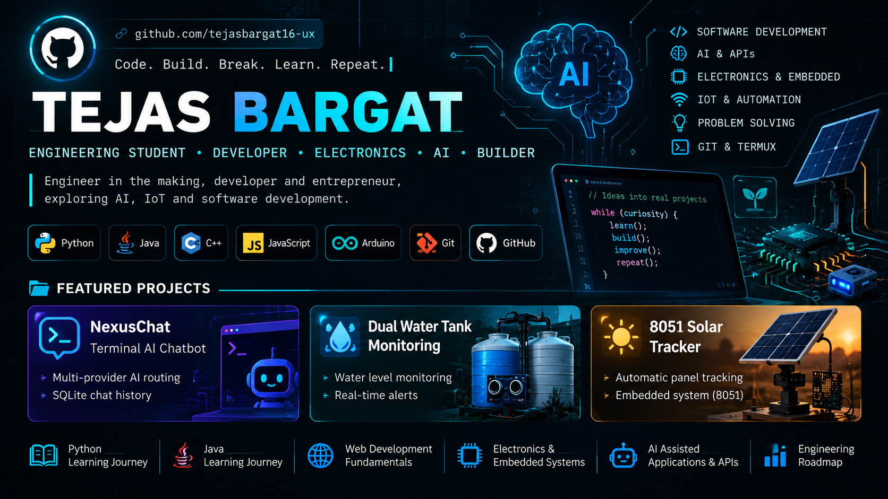

  

    

  

    

  
  
  
  

    

  

 

### 👤 About

- **Study**: 2nd-year B.Tech in Electronics & Communication Engineering (ECE) with a Computer Science & Engineering (CSE) minor at TGPCET (RTMNU), Maharashtra.
- **Building**: Embedded IoT prototypes (dual water tank controller, 8051 solar tracker) and AI-driven software systems (Nexus AI, CampusCare AI) developed on Android via Termux.
- **Learning**: Digital circuit design, embedded C firmware, daily programming fundamentals across Python, Java, and C++, and structured preparation for GATE EC (2028).
- **Open to**: Engineering internships, technical collaboration, and open-source contributions in embedded systems, IoT, and software development.

 

### 🚀 Featured Projects

  

 

| Project | What it does | Tech | Status | Link |
| :--- | :--- | :--- | :--- | :--- |
| **Nexus AI** | Mobile-first personal AI assistant concept exploring conversational interaction, memory architecture, web search integration, and modular plugins. | `Python`, `AI APIs`, `Termux`, `FastAPI`, `SQLite` | `Building` | [Repo](https://github.com/tejasbargat16-ux/Nexus-AIOS) |
| **Dual Water Tank Monitoring System** | Two-tank water monitoring and automatic motor control system with sensor-based level detection, visual RGB status indicators, and audible buzzer alerts with overflow protection. | `Arduino UNO`, `ESP32`, `Sensors`, `Embedded C`, `Relay Control` | `Prototype` | [Repo](https://github.com/tejasbargat16-ux/water-tank-auto-controller) |
| **Solar Tracking System** | 8051 microcontroller-based solar tracking concept utilizing light-dependent resistor (LDR) differential sensing and motor-driver control logic to follow peak sunlight. | `8051 MCU`, `LDR Sensors`, `Stepper Motor`, `Embedded C`, `Automation` | `Prototype` | [Repo](https://github.com/tejasbargat16-ux) |
| **Tejas 2.0 Portfolio** | Responsive personal engineering portfolio showcasing skills, hardware builds, AI experiments, public learning streaks, and architectural design language. | `React 19`, `Vite`, `JavaScript`, `Modern CSS`, `GitHub Pages` | `Deployed` | [Demo](https://tejasbargat16-ux.github.io/tejasbargat16-ux/portfolio/) · [Repo](https://github.com/tejasbargat16-ux/Tejas-2.0-Portfolio) |
| **Programming Learning Journey** | Disciplined day-by-day public learning journey covering Python, Java, JavaScript, and C fundamentals, LeetCode problem solving, and practical micro-builds committed to GitHub. | `Python`, `Java`, `JavaScript`, `C`, `Termux`, `Git` | `Active learning` | [Repo](https://github.com/tejasbargat16-ux/Python-Learning-Journey) |
| **CampusCare AI** | AI-powered campus complaint management platform combining Flutter mobile frontend with FastAPI backend, featuring role-based access, issue tracking, image uploads, priority analysis, and admin dashboards. | `Flutter`, `FastAPI`, `Python`, `AI Priority Analysis`, `REST APIs` | `Building` | [Repo](https://github.com/tejasbargat16-ux/campuscareai_edition) |

 

### 🛠️ Tech Stack

  

 

| Domain | Skills & Technologies |
| :--- | :--- |
| **Languages** | `C` · `C++` · `Python` · `Java` · `JavaScript` · `Embedded C` |
| **Web** | `HTML5` · `CSS3` · `JavaScript (DOM)` · `Responsive Design` · `Frontend Development` |
| **Embedded & IoT** | `8051 Microcontroller` · `Arduino UNO` · `ESP32` · `ESP8266` · `Digital Electronics` · `Digital Circuit Design` · `Microcontrollers` · `Sensors & Interfacing` · `Internet of Things (IoT)` · `Automation Systems` · `Basic Circuit Design` |
| **AI** | `AI Application Dev` · `AI-assisted development` · `Prompt Engineering` · `AI Automation` · `AI Product Prototyping` |
| **Tools** | `VS Code` · `Git` · `GitHub` · `Termux` · `Pydroid` · `Android Dev Environment` |

 

### ⚡ Portfolio & NEXUS AI

- **React 19 + Vite Showcase**: A responsive web portfolio built with React 19 and Vite 8, featuring dark cinematic styling, an interactive 36-skill taxonomy, authentic project telemetry, and mobile-first design.
- **Embedded NEXUS AI Assistant**: Integrated natively into the portfolio with a dual-engine architecture to serve as a conversational engineering representative.
- **Client-Side Local Knowledge Engine**: Operates client-side on GitHub Pages with zero latency and no external API keys required, grounded strictly in verified academic, project, and skill data.
- **Optional Full-Stack LLM Backend**: Features automated rate limiting with graceful failover to local mode when connected to Google Gemini, Groq, or OpenAI via Node/Express or serverless endpoints.
- **Live Implementation**: Available online at [tejasbargat16-ux.github.io/tejasbargat16-ux/portfolio/](https://tejasbargat16-ux.github.io/tejasbargat16-ux/portfolio/).

 

### 🗺️ Roadmap 2026 → 2028

- **2026 · Build the Base**: Strengthen programming fundamentals, second-year ECE courses, and consistent daily project building in public.
- **2027 · Connect the Disciplines**: Deepen embedded systems, AI integrations, and full-stack engineering through practical, working prototypes.
- **2028 · Test the Foundation**: Prepare rigorously for GATE 2028 across CSE/ECE interests and evaluate advanced technical horizons.

 

### 📊 Dynamic Stats & Activity

  
  
    
  
    
  

 

### 📬 Contact

Open to engineering internships, technical collaborations, and research discussions.

- **Email**: [tejasbargat16@gmail.com](mailto:tejasbargat16@gmail.com)
- **LinkedIn**: [linkedin.com/in/tejas-bargat-9ab8523b0](https://www.linkedin.com/in/tejas-bargat-9ab8523b0/)
- **GitHub**: [github.com/tejasbargat16-ux](https://github.com/tejasbargat16-ux)
- **Location**: Maharashtra, India

 

  

